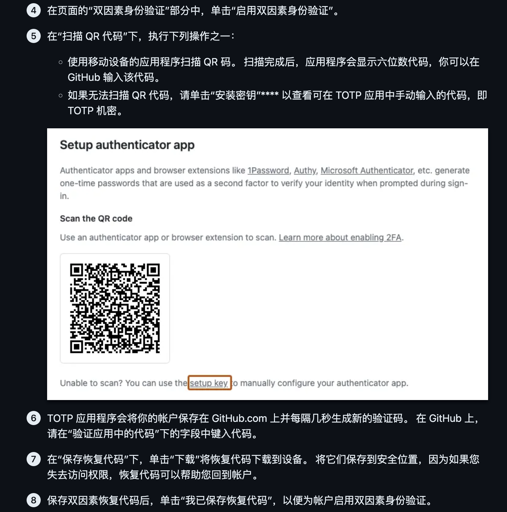
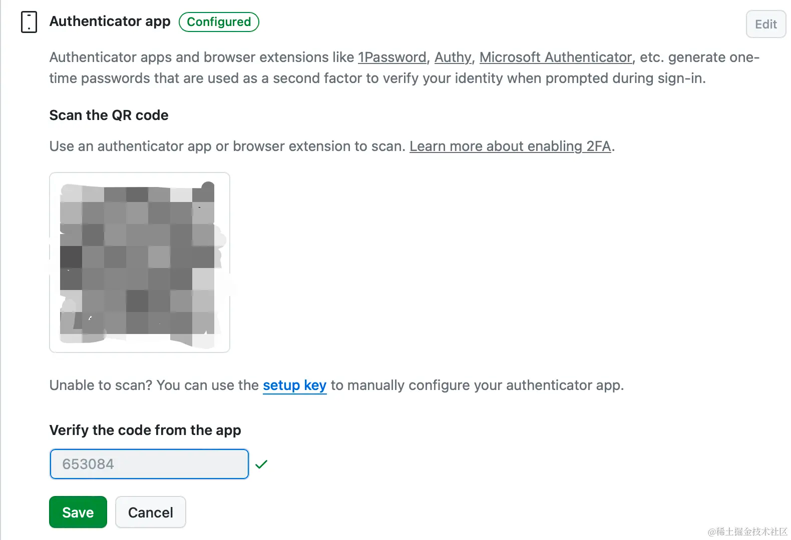
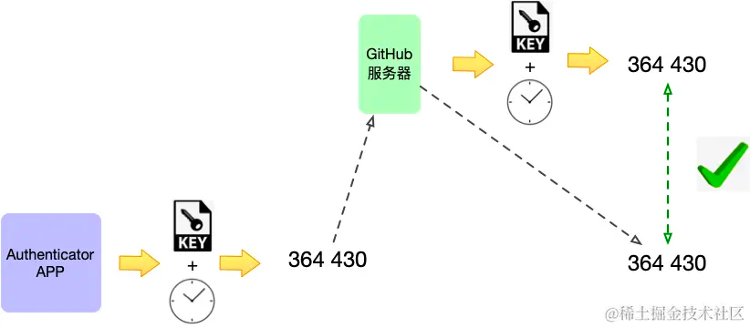
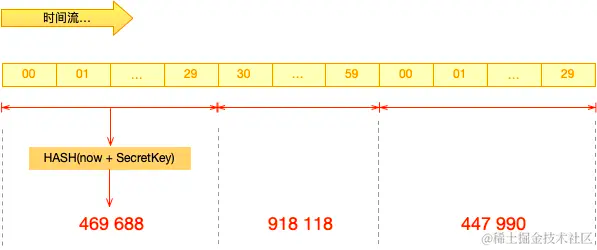

# Two-factor authentication 双重身份验证

双重身份验证 (2FA) 是登录网站或应用时使用的额外保护层。启用 2FA 时，必须使用您的用户名和密码登录，并提供另一种只有您知道或可以访问的身份验证形式。

在启用 2FA 后，只要有人尝试登录你的帐户，服务就会生成验证码。 用户能登录你的帐户的唯一方式是，他们知道你的密码，且有权访问你手机上的验证码。

配置 2FA 后，可以通过基于时间的一次性密码 (TOTP) 移动应用或短信添加安全密钥，例如 FIDO2 硬件安全密钥、Apple Touch ID 或 Windows Hello。 启用安全密钥身份验证的技术称为 WebAuthn。 WebAuthn 是 U2F 的继承者，适用于所有现代浏览器。

为确保帐户安全，强烈建议启用 2FA，在支持 2FA 的其他网站和应用上也要启用。

如果未启用 2FA，可能会要求进行其他验证，以确认首次从新设备或未识别设备登录的用户是你本人。

新设备仅需验证一次。 如果清除 Cookie，或者在同一设备上使用不同的浏览器， GitHub 可能会要求你再次验证设备。

## 配置2FA

可以选择多个选项，以向帐户添加第二个身份验证源。

可以在移动或桌面 上使用 TOTP 应用或通过短信配置双重身份验证（2FA）。 使用 TOTP 应用 或通过短信配置 2FA 后，还可以将安全密钥添加为备用 2FA 方法。

强烈建议使用基于时间的一次性密码（TOTP）应用程序将 2FA 和安全密钥配置为备份方法，而不是短信。 TOTP 应用程序比短信更可靠，尤其是在美国境外的地区。 许多 TOTP 应用支持在云中安全地备份验证码，如果你失去对设备的访问权限，可以进行恢复。

### 使用 TOTP 应用配置双重身份验证

基于时间的一次性密码 (TOTP) 应用程序可自动生成在特定时间后变化的验证码。 可以将这些应用下载到手机或桌面。 我们建议使用基于云的 TOTP 应用。 在 TOTP 应用方面不受特定应用限制，因此你可以自由选择任何你喜欢的 TOTP 应用。 只需在浏览器中搜索 TOTP app 即可查找各种选项。



#### 手动配置 TOTP 应用

如果无法扫描安全 QR 代码或者想要手动安装 TOTP 应用，则需要在 QR 代码中编码以下参数，这些参数包括：

类型：TOTP
标签：其中 WestMobi:<username> 是 WestMobi 上的句柄的 <username>，例如 monalisa
机密：这是编码的设置密钥，在配置过程中单击“设置密钥”时会显示
颁发者：WestMobi
算法：默认使用 SHA1。
位数：默认使用 6 位数
时间段：默认时间为 30 秒。

#### Google 验证器（Google Authenticator）

Google 验证器（Google Authenticator）是一款提供双因素认证（2FA）的安全应用，它通过在手机上生成动态验证码来为您的在线账号提供第二层安全保护。

Authenticator 应用的核心原理是通过预共享密钥和时间同步，使用TOTP 算法生成一次性验证码，实现 "你知道的 (密码)+ 你拥有的 (设备)" 的双因素认证，大幅提升账户安全性。

[0]: https://docs.github.com/zh/authentication/securing-your-account-with-two-factor-authentication-2fa/about-two-factor-authentication "Github 关于双因素身份验证"
[1]: https://totp.app/ "Online one-time password generator / TOTP (Google Authenticator) Online / 2FA"

---

## 设计

整体流程

```text
用户输入 用户名+密码+图片验证码
        │
        ▼
  后端校验通过 ──► 用户未启用MFA? ──是──► 直接颁发 token，登录完成
        │
        否（已启用MFA）
        │
        ▼
  返回 needMfa=true + mfaToken（5分钟有效临时凭证）
        │
        ▼
  前端跳转到 /mfa-verify，用户输入 Google Authenticator 6位码
        │
        ▼
  后端校验 TOTP 通过 → 颁发正式 token → 进入系统
```

1. 启用双因素认证
    
   1. 登录账号，选择设置
   2. 在侧边栏中，点击安全(Security)
   3. 在“Two-factor authentication”（双因素认证）部分，点击“Enable two-factor authentication”（启用双因素认证）按钮
   4. 可以选择“Authenticator app”（身份验证器应用）或“Text message”（短信）作为你的2FA方法

   **使用身份验证器应用（推荐）**
   1. 选择“Authenticator app”（身份验证器应用）
   2. 使用你的手机下载并安装一个身份验证器应用，如 Google Authenticator 或 Authy
   3. 在 WM 设置页面上，使用你手机上的身份验证器应用扫描显示的 QR 码
   4. 你的身份验证器应用会显示一个6位数的代码
   5. 在 WM 上输入这个6位数的代码以完成设置
   6. 点击“Enable two-factor authentication with an authenticator app”（使用身份验证器应用启用双因素认证）
    
    **使用短信**
    1. 选择“Text message”（短信）
    2. 输入你的手机号码
    3. 点击“Send”（发送）按钮，WM 会向你的手机发送一个验证码
    4. 输入你收到的验证码
    5. 点击“Enable”（启用）按钮

2. 配置恢复码

在启用2FA时，WM 会提供一组恢复码。请务必将它们保存在安全的地方，以防止你失去设备的访问权限时能够恢复账户。

   1. 将恢复码打印出来或记在某个安全的地方
   2. 不要将恢复码存储在手机上或与2FA相关的任何地方

3. 使用 WM 时的2FA

启用2FA后，每次登录 WM 时，你都需要输入由身份验证器应用生成的6位数代码。

### 认证步骤

1. 生成绑定二维码
2. TOTP 应用/插件扫码绑定
3. 登录账号后输入 TOTP 验证码
   账号密码登录成功后，继续输入并验证 TOTP 验证码

### 基本原理

验证码生成器和 WM 各自使用相同的秘钥对当前时间采用相同的 TOTP 算法生成的一组 6 位数字，对比双方生成的结果，相同则验证通过。

这种验证方法的高明之处在于：

- 不是直接输入秘钥判断双方拥有的秘钥是否一致（账号密码机制），**有效防止秘钥泄露**。
- 采用离线的 Authenticator 应用/插件生成，**避免传输过程被第三方拦截**（短信验证码）

#### 传递秘钥

点击启用 2FA 双重认证时，WM 会给出一个绑定二维码

二维码解码出来的内容为：

```text
otpauth://totp/WestMobi:JohnieXu?secret=A8XTDOHEKE6TIHHQ&issuer=WestMobi
```

当使用 Authenticator 应用扫码时，会解析这里面的参数存储到手机上。

其中，`secret=` 后面的部分就是最关键的秘钥。

> 有很多 APP 都支持这种二维码，例如：GitHub、1Password、Authy 等，可以看出这种双重认证方式比较开放

#### 确认绑定

这一步是告诉 WM 我已经保存了刚刚这个秘钥，下次我们就约定使用这个秘钥进行双重认证。

具体过程为：

   - Authenticator 应用和 WM 服务器各自按照 TOTP 算法生成验证码进行对比，相同则验证通过。
   - 通过后，WM 就会将这个秘钥与你的账号关联，下次双重认证时使用这个秘钥。
      

#### TOTP 算法生成验证码

Authenticator 应用把秘钥和当前时间一起进行哈希运算，生成六码数字作为验证码。

所以，**生成的验证码随着当前时间不断变化，并且无法根据验证码反推出秘钥**。

但是，在 Authenticator 应用中可以看到验证码有 30s 的有效期，并且在 30s 内生成的验证码是一样的。

这是因为：用来哈希运算的时间戳还进行了 30s 分段，相当于将当前时间戳除以 30 再取整再作为哈希运算的内容。

#### 验证是否有效

在 WM 页面输入验证码时，验证码会被发送到 WM 服务器。

WM 用相同的算法以服务器当前时间来生成 6 位验证码，与接收的验证码对比，相同则验证通过。



这个验证过程会存在一个问题：

**如果 Authenticator 验证码生成的时间，与 WM 生成的验证码不在一个 30s 间隔内，那么会验证失败。**

### TOTP原理

TOTP 全称是基于时间的一次性验证码，是 OTP（一次性验证码）的一种，已经是国际标准规范：RFC-6238。

#### 验证码生成过程



用公式表示如下：

使用当前时间戳 TC 与秘钥 SecrectKey 进行哈希运算

```text
TOTP = HASH(SecretKey, TC)
```

> HASH：哈希函数，一般是 SHA-1

TC 是从起始时间 T0 到当前时间的总秒数，再除以时间间隔 TS 并取整

```text
TC = floor((unixtime(now) − unixtime(T0)) / TS)
```

> floor： 表示取整，unitxtime：unix 格式的时间戳，now：当前时间 T0：约定的起始时间 TS：验证码有效间隔时间，一般是：30s、60s

一般约定从 `1970 年 1 月 1 日` 起，T0 就是 0

```text
TC = floor(unixtime(now) / 30)
```

生成公式汇总如下：

```text
TOTP = HASH(SecretKey, floor(unixtime(now) / 30))
```

TOTP 的基本原理就是这样，更多细节可以查看这份 RFC-6238。

### 问题解答

1. 为什么需要时间间隔

   如果不定义时间间隔那么每一秒的验证码都是不同的，在服务器校验验证码时永远不可能通过，因为双方生成验证码时一定存在时差。

2. 不在同一间隔内如何处理

   导致不在一个 30s 间隔的原因大概有：

   1. 发送验证码到 GitHub 服务器网络超时
   2. Authenticator 应用生成验证码在第 29s，而 GitHub 生成验证码在第 31s，恰好处于两个 30s 间隔中
   3. Authenticator 应用生成验证码时手机系统时间设置不正确

   这个问题已经超出了 TOTP 算法的范围，不同的服务商对此有不同的解决方案。

   RFC 文档中建议的解决方案是：

   对于第一、二种情况，一定是服务器收到验证码时间晚于生成验证码时间，依次从当前时间间隔往前推移几个间隔，只要其中一个间隔的验证码匹配上就认为验证通过。

   对于第三种情况，修改手机系统时间的自由度太大了，双重认证机制已经无法控制，这个场景验证码验证肯定失败。

   > 现在手机都会自动同步网络时间，大概率不会出现；另外，猜测 Authenticator 应用也会对比系统时间和网络时间，不一致时会给出提示。

3. 如何保证安全

**秘钥泄露**

主要存在下面几种可能：

- 在扫描 WM 给的绑定二维码时，如果被别人拍照、截图、数据劫持，二维码中的秘钥就会泄露
- Authenticator 应用存储的秘钥被泄露，手机丢失、Authenticator 服务器被攻击等

拿到了秘钥之后按照 TOTP 算法生成验证码肯定是有效的，不过前提是对方知道了你的 WM 的账号和密码。

所以，选择一款可靠的 Authenticator 应用很关键，建议使用大厂的应用或者开源应用，甚至自己开发一款 TOTP 验证码生成应用。

**破解秘钥**

有两种破解可能：

- 尝试验证码

验证码只有 6 位数字长度、总共有 2^6 种可能，逐个尝试（暴力破解）

破解的时间有限，验证码每隔一个时间间隔（30s）就会更新，同时 WM 有网关安全识别，频繁的请求会被视为网络攻击直接过滤掉，几乎不可能完成

- 推测秘钥

收集验证成功的 TOTP 验证码，根据 TOTP 算法尝试出原始秘钥

这种方式要尝试所有可能的秘钥值、同时要知道成功的 TOTP 验证码生成的时间戳，几乎不可能完成

### 双重认证非常安全

从分析的过程可以看出这种双重认证非常安全，就算账号密码泄露了，只要手机还在，你的账号也还是安全的。